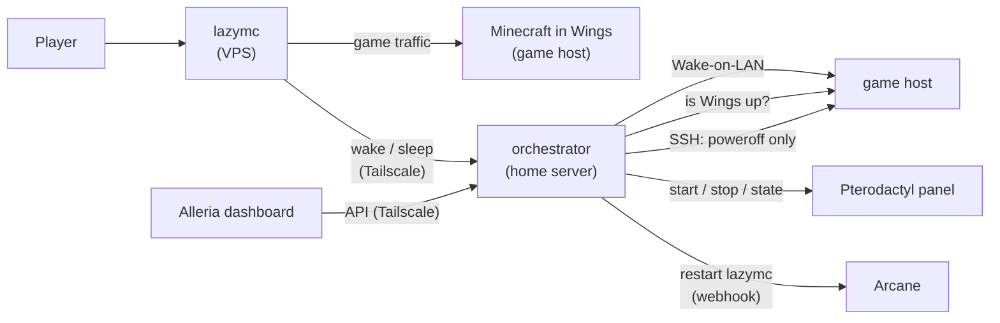

# mcwake

Automatic wake and sleep for a whole physical Minecraft server. Players
connect to the same address at all times; the machine running the game
stays powered off between sessions instead of burning electricity around
the clock for a few hours of play.

When someone joins a sleeping server they get a "server is starting"
message, while in the background the machine is woken with Wake-on-LAN,
Pterodactyl starts the Minecraft server, and the player can join as soon
as it answers. When nobody plays for a while, the server is stopped; after
a longer silence the whole machine is powered off.

The management panel is part of the Alleria dashboard, which talks to the
orchestrator's API (below).

## How it works

Two idle tiers, so a short break does not cost a cold boot and a long one
really saves power:

1. **Sleep (lazymc)** — `sleep_after` after the last player leaves, only
   the Minecraft server is stopped. The machine stays on, so coming back the
   same day takes seconds.
2. **Idle shutdown (orchestrator)** — after a long silence (7 days by
   default), the machine is powered off. Counted from a last-activity time
   kept in SQLite, so it survives restarts of lazymc and of the orchestrator.

`SLEEP_TRIGGERS_FULL_SHUTDOWN` collapses the two into one: lazymc's
threshold then powers the machine off directly.



- **lazymc** (`lazymc/`, on a VPS) — the address players connect to. It
  proxies game traffic to the real server and runs `bridge/wake.sh` as its
  "server process": starting it asks the orchestrator to wake, stopping it
  asks the orchestrator to sleep. Player sessions go VPS → game host
  directly, so they survive a restart of the home server.
- **orchestrator** (`orchestrator/`, on the always-on home server) — all the
  logic, one Node process: wake, sleep, idle shutdown, player activity,
  stats, panel settings and maintenance mode. It must live on the home LAN:
  the game host cannot wake itself.

### Waking

1. Maintenance mode on → refused, nothing is touched.
2. Wings answers on `WINGS_URL` → fast path. Otherwise a Wake-on-LAN packet
   goes out (and again every 30 seconds) until Wings answers.
3. Pterodactyl starts the server unless it is already running.
4. Done once Minecraft answers a status ping on `MC_SERVER_HOST`.

### Sleeping and powering off

- **Sleep**: refused while anyone is still connected (checked by pinging the
  real server, which also sees players who did not come through lazymc);
  otherwise Pterodactyl stops the server. A server that hangs on shutdown
  gets `MC_STOP_GRACE_MINUTES`, then a kill — which does not save the world,
  hence the long grace period.
- **Power off**: stops the server as above, then
  `ssh <HOST_SSH_TARGET>` with a key whose authorized_keys entry runs
  `systemctl poweroff` and nothing else.

Wake, sleep and power-off **take turns** (`src/power.ts`): a wake that
arrives while the machine is shutting down waits for the shutdown and then
wakes it from cold, instead of starting a server the poweroff is about to
cut off. Concurrent wake requests share one run.

### Maintenance mode

A switch in the dashboard for servicing the machine. lazymc's `[lockout]`
kicks every join before any wake logic runs, and the orchestrator refuses
`/wake` on its own, whatever asked for it. Toggling it restarts lazymc
(through the Arcane webhook) so the message applies at once — that
disconnects connected players, which is why the dashboard asks first.

## Configuration

Everything is in `.env` (copy `.env.example`; every variable is commented
there). Texts and thresholds can be overridden from the dashboard — those
overrides live in SQLite, `.env` only gives the starting values.

### The game host

Ubuntu with Wings installed straight on the machine.

1. **Wake-on-LAN**: in the BIOS, ErP off and "Resume by PCI-E" (or similar)
   on; on Linux, `wakeonlan: true` on the interface in netplan, so the
   network card keeps listening after poweroff. Check with
   `ethtool <interface> | grep Wake-on` (it should say `g`).
2. **Poweroff key**: generate it in the orchestrator's volume and put the
   host's key next to it (an unknown host key fails rather than being
   trusted):
   ```
   docker compose exec orchestrator ssh-keygen -t ed25519 -N "" -C mcwake-poweroff -f /data/ssh/id_ed25519
   ```
   and on the host, one line in `/root/.ssh/authorized_keys`:
   ```
   restrict,command="/usr/bin/systemctl poweroff",from="<WOL_LAN_ADDRESS>" ssh-ed25519 AAAA... mcwake-poweroff
   ```
   `/data/ssh/known_hosts` holds `<host> ssh-ed25519 AAAA...`, taken from the
   host's `/etc/ssh/ssh_host_ed25519_key.pub`.
3. **Firewall**: let `WOL_LAN_ADDRESS` reach Wings' API port and SSH.

### The orchestrator's LAN leg

From Docker's default bridge, a packet to the LAN broadcast address is
delivered to the Docker host itself and never leaves it. So the
orchestrator is also attached to an existing ipvlan/macvlan network of the
Docker host (`br0` on Unraid) at a fixed `WOL_LAN_ADDRESS`, while its
default route stays on the bridge (`gw_priority`). The API drops any
connection that arrives on the LAN address: it is reachable only through
the published port on the Tailscale address.

### Pterodactyl

A **Client API** key (not the Application API) of an account that has
access to the server → `PTERODACTYL_API_KEY`; the server's 8-character id
from its panel address → `PTERODACTYL_SERVER_ID`. Ideally a dedicated
account, added to this one server as a subuser with power permissions only.

### lazymc on the VPS

`docker-compose.vps.yml`, deployed by Arcane GitOps. Its own `.env` needs
`PUBLIC_PORT`, `MC_SERVER_HOST`/`MC_SERVER_PORT` (how the VPS reaches the
game server), `ORCHESTRATOR_URL` (the home server's Tailscale address and
port) and `ORCHESTRATOR_INTERNAL_TOKEN` — set to the orchestrator's
`ORCHESTRATOR_LAZYMC_TOKEN`, so the VPS holds a token that can only wake,
sleep and read lazymc's config. An Arcane webhook that restarts the lazymc
project goes into the orchestrator's `ARCANE_LAZYMC_WEBHOOK_URL`.

## Installation

```bash
cp .env.example .env    # fill it in
docker compose up -d --build
```

The container runs as an unprivileged user with a read-only filesystem and
no capabilities; its state (SQLite, logs, the SSH key) is the
`mcwake-data` volume.

## API

Every route except `/health` needs `Authorization: Bearer <token>`.

| Route | Who | |
|---|---|---|
| `GET /health` | anyone | liveness, for the container healthcheck |
| `POST /wake` | lazymc, admin | wake and start; answers when Minecraft is up |
| `POST /sleep` | lazymc, admin | stop the server (or power off, in the one-tier model) |
| `GET /config/lazymc` | lazymc, admin | lazymc's settings as shell-sourceable lines |
| `POST /admin/shutdown-host` | admin | power the machine off; answers at once |
| `POST /admin/maintenance` | admin | `{enabled}`; restarts lazymc |
| `POST /admin/restart/lazymc` | admin | apply settings lazymc reads at start |
| `GET`/`POST /config/settings` | admin | panel settings (`{key, value}`, `null` resets) |
| `GET /status`, `/activity`, `/components`, `/stats`, `/logs` | admin | state for the dashboard |

"admin" is `ORCHESTRATOR_INTERNAL_TOKEN` (the dashboard), "lazymc" is
`ORCHESTRATOR_LAZYMC_TOKEN`.

## Large modpacks (Forge) and status-ping

lazymc polls the real server's status-ping to see that it is up. Two
problems show up with large modpacks:

1. **The whole status response is limited to 32 KB**, and an unoptimised
   `server-icon.png` can exceed that once base64-encoded. Use a small,
   well-compressed icon (the server reads it once, at start).
2. **Forge appends a mod list (`forgeData`)** in a shape lazymc's protocol
   library cannot parse, and the MOTD is sometimes a chat-component object.
   `lazymc/patches/monitor.rs` (applied in its Dockerfile) retries a failed
   parse after stripping `forgeData`/`modinfo` and flattening the
   description; lazymc does not use that data anyway.

## Development

```bash
cd orchestrator
npm install
npm test      # builds, then runs the tests in dist/
```

Security review: [docs/audyt-bezpieczenstwa-2026-10-20.md](docs/audyt-bezpieczenstwa-2026-10-20.md).
